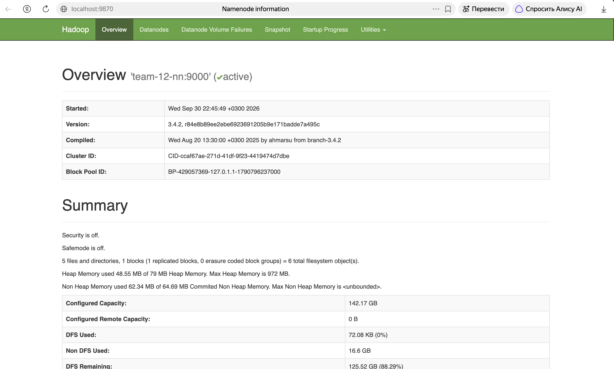
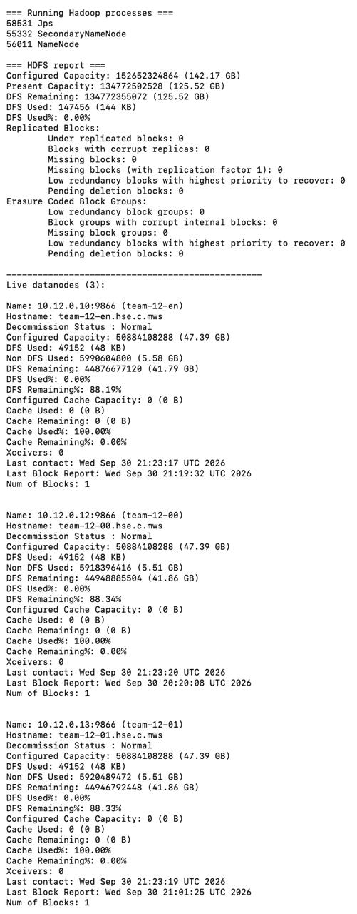
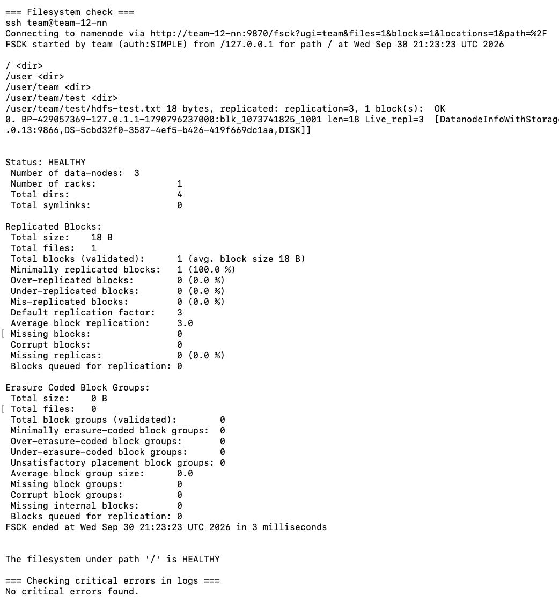

# ДЗ №1 — развёртывание HDFS-кластера

Кластер из 4 машин: NameNode + Secondary NameNode на одном хосте и 3 DataNode.

| Hostname     | IP          | Роль                          |
| ------------ | ----------- | ----------------------------- |
| `team-12-nn` | 10.12.0.11  | NameNode + Secondary NameNode |
| `team-12-en` | 10.12.0.10  | DataNode                      |
| `team-12-00` | 10.12.0.12  | DataNode                      |
| `team-12-01` | 10.12.0.13  | DataNode                      |

ПО: Ubuntu 24.04, Java 17, Hadoop 3.4.2. Ставится в `/opt/hadoop` (симлинк на `/opt/hadoop-3.4.2`).

## Структура

```text
config/
  core-site.xml      fs.defaultFS = hdfs://team-12-nn:9000
  hdfs-site.xml      replication 3, каталоги данных, адреса NN и SNN
  workers            список DataNode
  hadoop-env.sh      JAVA_HOME, HADOOP_HOME
scripts/
  deploy_cluster.sh     полное развёртывание
  install_hadoop.sh     Java + Hadoop
  configure_hadoop.sh   копирует конфиги, создаёт каталоги
  format_namenode.sh    форматирование NameNode
  start_cluster.sh      start-dfs.sh
  stop_cluster.sh       stop-dfs.sh
  check_cluster.sh      проверка состояния
```

## Настройка SSH

Вход на кластер через edge-ноду, внутренние узлы доступны только с неё по ключу `team_internal`:

```bash
ssh team@171.22.72.54
scp -i ~/.ssh/team_internal ~/.ssh/team_internal team@team-12-nn:~/.ssh/
ssh -i ~/.ssh/team_internal team@team-12-nn
```

На `team-12-nn` настраиваем ssh config, чтобы скрипты и `start-dfs.sh` ходили по узлам
без указания ключа:

```bash
cat > ~/.ssh/config <<'EOF'
Host team-12-en team-12-nn team-12-00 team-12-01
    User team
    IdentityFile ~/.ssh/team_internal
    StrictHostKeyChecking accept-new
EOF
chmod 600 ~/.ssh/config ~/.ssh/team_internal
```

Проверяем, что подключение идёт без пароля:

```bash
ssh team-12-en hostname
ssh team-12-00 hostname
ssh team-12-01 hostname
```

## Запуск

Дальше всё делает один скрипт, запускать с `team-12-nn`:

```bash
bash scripts/deploy_cluster.sh
```

Он проверяет SSH, ставит Java и Hadoop на все 4 узла, раскладывает конфиги, создаёт
`/data/hdfs/{namenode,datanode,namesecondary}` с владельцем `team`, при первом запуске
спрашивает подтверждение на форматирование NameNode, поднимает HDFS и проверяет кластер.

Если метаданные NameNode уже есть, форматирование не делается — данные не потеряются.

Отдельные шаги можно выполнять вручную:

```bash
sudo bash scripts/install_hadoop.sh
sudo bash scripts/configure_hadoop.sh
bash scripts/format_namenode.sh     # только для нового кластера!
bash scripts/start_cluster.sh
bash scripts/stop_cluster.sh
```

## Проверка

```bash
bash scripts/check_cluster.sh
```

Скрипт показывает версию Hadoop, процессы через `jps`, `hdfs dfsadmin -report`,
`hdfs fsck /` и ищет FATAL/ERROR в логах.

Веб-интерфейс NameNode: `http://team-12-nn:9870` (Secondary NameNode — порт 9868).
Адреса внутренние, поэтому снаружи UI открывается через SSH-туннель:

```bash
ssh -L 9870:team-12-nn:9870 team@171.22.72.54
```

После этого интерфейс доступен на `http://localhost:9870`.

## Результат

Кластер собрался и работает. `jps` на `team-12-nn` показывает `NameNode` и
`SecondaryNameNode`, на каждом из трёх остальных узлов — `DataNode`.

`hdfs dfsadmin -report`:

```text
Live datanodes (3):

Name: 10.12.0.10:9866 (team-12-en)
Decommission Status : Normal

Name: 10.12.0.12:9866 (team-12-00)
Decommission Status : Normal

Name: 10.12.0.13:9866 (team-12-01)
Decommission Status : Normal

Under replicated blocks: 0
Blocks with corrupt replicas: 0
Missing blocks: 0
```

`hdfs fsck /`:

```text
/user/team/test/hdfs-test.txt 18 bytes, replicated: replication=3, 1 block(s):  OK

Status: HEALTHY
 Number of data-nodes: 3
 Default replication factor: 3
 Average block replication: 3.0
 Missing blocks: 0
 Corrupt blocks: 0
```

В Web UI NameNode 3 живых DataNode, деградировавших нет. В логах критических ошибок нет.
Тестовый файл `/user/team/test/hdfs-test.txt` записан с фактором репликации 3 —
по одной реплике на каждой DataNode.






